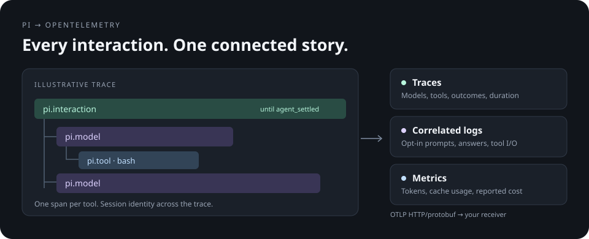

# pi-otel



Traces, logs and metrics for Pi 1.6.0 (Node 22.19+). Send OTLP HTTP/protobuf to your receiver, including [sigiro](https://sigiro.com).

## Install

Load pi-otel only once per session to avoid duplicate telemetry.

```sh
pi install git:github.com/akshatagarwl/pi-otel
```

Create `~/.pi/agent/pi-otel.json`, protect it with `chmod 600`, then start a new session:

```json
{
  "endpoint": "http://127.0.0.1:4318",
  "content": false
}
```

**Content is off by default.** Setting `"content": true` exports full prompts, assistant content (including exposed reasoning), preflight tool arguments and results/details. These may contain secrets or personal data. There is **no content redaction or extension-level truncation**.

Use `/otel-status` to check enablement, privacy and diagnostic failures without exposing endpoint, headers or content.

## What you get

| Signal | Captures |
| --- | --- |
| Traces | Interaction → model → tool spans, outcomes and durations |
| Logs | Opt-in content with actual OTLP trace/span correlation |
| Metrics | Disjoint token/cache buckets and Pi-reported USD cost |

Illustration above, not a dashboard screenshot. Delivery is bounded and best-effort, not durable.

<details>
<summary>Configuration & privacy</summary>

The endpoint is a base URL; `/v1/traces`, `/v1/logs`, `/v1/metrics` are appended. No endpoint means disabled. Configuration is read at session start. Environment overrides: `PI_OTEL_ENDPOINT`, `PI_OTEL_CONTENT` (`true` or `false`), `PI_OTEL_HEADERS` (JSON string-to-string object), `PI_OTEL_SERVICE_NAME` (default `pi`, also configurable as `serviceName`). Remote endpoints are allowed only when explicitly configured; use HTTPS and appropriate authentication.

JSON bodies have UTF-8 byte counts. Cyclic/non-JSON-serializable values are omitted and counted as diagnostic failures. Pi itself may already have truncated tool output. Provider request histories and system prompts are not captured.

</details>

<details>
<summary>Technical contract & delivery limits</summary>

Uses official OpenTelemetry JS SDKs. No global providers, context managers, tool overrides, or provider payload interception.

- One interaction root until `agent_settled`, including retries; `agent_end` does not close it. Child model failures remain errors even after recovery. A successful final model response makes the interaction successful; failed tools remain independently marked.
- Model spans cover Pi assistant message lifecycle, not individual HTTP attempts. Provider/model are taken from Pi. Finish reasons and generic error types are recorded; raw provider error strings are not.
- One span per tool call, including blocked/invalid calls. Parallel calls use independent contexts; nested calls use `parentToolCallId`. Tool spans parent to the originating model span (which may already have ended). `pi.tool.execution.duration_ms` is Pi's supplied execution duration; wall span duration includes preflight/scheduling. `tool.preflight.input` precedes later input-mutating hooks and is not claimed to be the executed input.
- Cancellation has `pi.outcome=cancelled`, not ERROR. Pending spans close on settlement or session shutdown. Reload/new/resume/fork recreate the runtime; tree navigation does not.
- Content logs carry explicit OTel context, producing actual OTLP `traceId`/`spanId`, plus readable correlation attributes. Conversation identity appears only on spans/logs, never metric dimensions.
- `pi.tokens` is a cumulative monotonic counter with **disjoint Pi buckets** `input`, `output`, `cacheRead`, `cacheWrite`. Input is not the inclusive GenAI input metric. Reasoning is already part of output and is not added again. Usage is recorded once per assistant `message_end`; failed requests contribute only usage Pi actually reports.
- `pi.cost` sums Pi's reported USD total, labeled `pi.cost.source=provider` when `totalFromProvider` is true, otherwise `estimated`. Never sums the total plus its components. Dimensions are provider/model and bucket/source, not session/tool IDs. Random `service.instance.id` isolates counter lifetimes across processes and replacement runtimes; no session-history replay.

`/otel-status` reports enablement/privacy, pending tools and diagnostic failures without exposing endpoints, headers or content. Diagnostic failures include exporter errors and serialization failures. The extension never prints exporter errors itself or installs a global diagnostic logger.

Shutdown is idempotent and awaits exporters for at most four seconds (transport timeout two seconds). SDK batch queues are bounded; saturation, receiver rejection, shutdown timeout, or abrupt process termination can lose telemetry. This is not durable delivery or zero-overhead instrumentation. Receiver-side payload limits still apply.

</details>

## Library use

`pi-otel/adapter` exports `OTelTelemetryAdapter`, a `@earendil-works/pi-telemetry` adapter. Pass it your own OTel tracer and, optionally, a meter. It registers no global providers and captures no content.

## Development

```sh
pnpm install --frozen-lockfile
pi -e ./src/index.ts      # try a local checkout
pnpm check && pnpm build && pnpm test
```

Tests use synthetic data only and run against the real Pi 1.6.0 extension loader. They do not call a live model.
